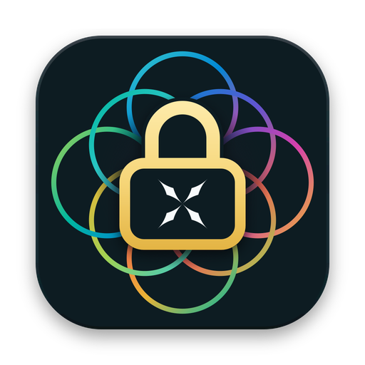
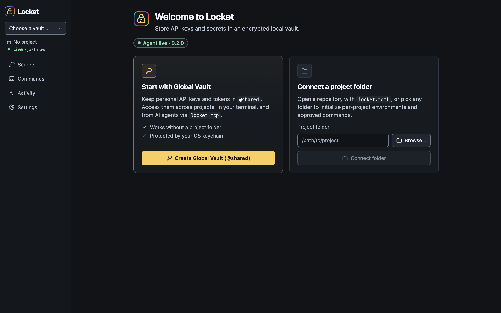
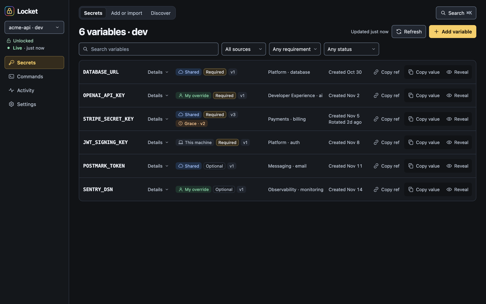
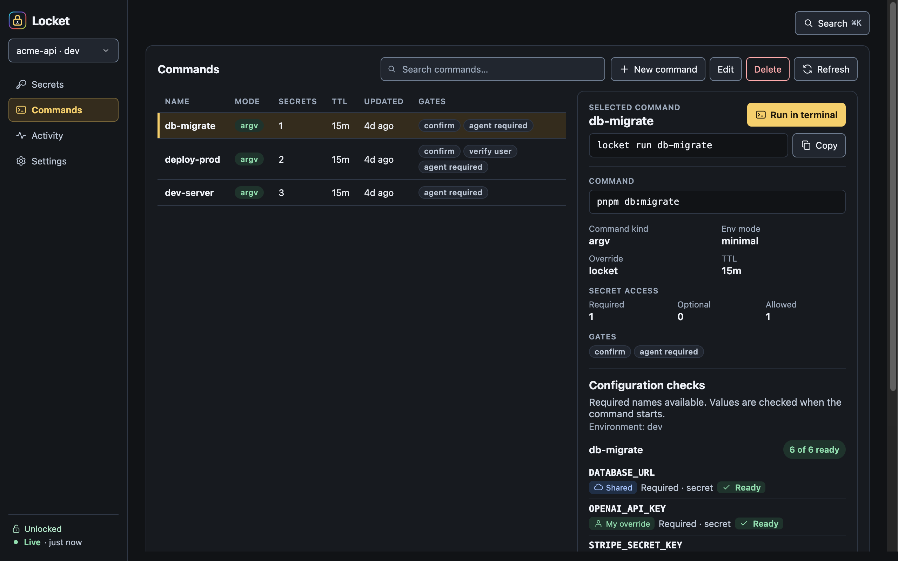
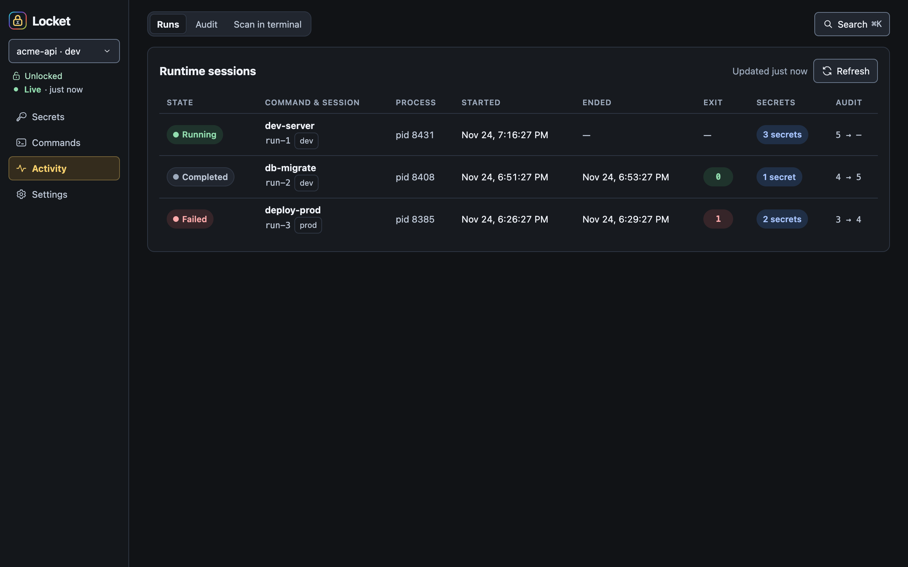

<div align="center">



# Locket

### Your development variables, encrypted locally and ready to run.

<p>
  
  
  
  
  
</p>

<em>Replace plaintext <code>.env</code> files with an encrypted vault, explicit policy,<br/>and delivery to the commands you approve.</em>

<br/>

<sub>
  🔐&nbsp;Encrypted&nbsp;&nbsp;·&nbsp;&nbsp;🎯&nbsp;Capability-scoped&nbsp;&nbsp;·&nbsp;&nbsp;🧭&nbsp;Project&nbsp;+&nbsp;Profile&nbsp;&nbsp;·&nbsp;&nbsp;🤖&nbsp;AI-safe&nbsp;local&nbsp;context&nbsp;&nbsp;·&nbsp;&nbsp;🚫&nbsp;No&nbsp;Telemetry
</sub>

</div>

<br/>

> Store API keys in your local Global Vault (`@shared`) or connect a project folder to import `.env`, approve which variables a command can use, and run it with Locket. Values stay encrypted in your local vault. Project configuration and variable names can go in Git; secret values stay out of it. Locket collects no telemetry.

---

## Desktop Companion

Start with a personal Global Vault (`@shared`) in one click, or connect any repository with `locket.toml`. Primary navigation focuses on **Secrets**, **Commands**, **Activity**, and **Settings**, with a unified vault switcher in the sidebar and `⌘K` command search.

<table>
  <tr>
    <td></td>
    <td></td>
  </tr>
  <tr>
    <td align="center"><sub><strong>First-run Welcome</strong>: Start with Global Vault (<code>@shared</code>) or connect a project folder</sub></td>
    <td align="center"><sub><strong>Secrets</strong>: Metadata, source badges, grace windows, and gated copy/reveal</sub></td>
  </tr>
  <tr>
    <td></td>
    <td></td>
  </tr>
  <tr>
    <td align="center"><sub><strong>Commands</strong>: Approved command policies, detail pane, and readiness checks</sub></td>
    <td align="center"><sub><strong>Activity</strong>: Recorded runs, audit chain verification, and terminal scan handoff</sub></td>
  </tr>
</table>

## Why Locket

- 🔐 **Encrypted local vault**: Your secrets stay sealed at rest and unlock only when you ask.
- 🌐 **Global Vault (`@shared`) and MCP**: Store personal API keys once and use them across projects, terminals, and AI tools via `locket mcp`.
- 🎯 **Capability-scoped delivery**: `locket run`, `locket exec`, Docker, and Compose helpers inject secrets into one child process.
- 📋 **Explicit command policies**: Declare which secrets a command may receive, and Locket enforces the rule.
- 🧭 **Project and profile workflows**: Keep `dev`, `staging`, and per-machine secrets cleanly separated.
- 🛠️ **Shell, editor, desktop, and tray integrations**: Local status, approvals, metadata history, and `lk://` reference resolution.
- 🔄 **Rotation, history, and diffs**: Rotate values safely and compare profiles without revealing plaintext.
- 🧹 **Scanner, pre-commit, redaction, and AI-safe tools**: Keep secrets out of code, logs, and prompts before sharing context with local AI agents.
- 🪪 **Recovery and device trust**: Local verification, recovery rotation, and sealed export/import without a hosted service.
- 👥 **Team sync and headless CI/CD**: Deliver signed, per-device encrypted updates through AWS S3, Cloudflare R2, Backblaze B2, MinIO, WebDAV, or a shared folder. Use `locket ci exec` to run a CI command with secrets from a verified snapshot. Both workflows use your storage and need no dedicated Locket server or SaaS account. [Team setup guide](docs/team-updates.md) · [CI/CD guide](docs/ci-cd.md)
- 🧾 **Metadata-only audit and diagnostics**: Report what happened without exposing secret values.
- 🚫 **No telemetry or analytics**: Network access is limited to opt-in update checks and user-configured encrypted delivery.

## Project Files

- `locket.toml` lives in the project and contains shareable configuration, policies, and metadata.
- Monorepos can add `[paths."<relative/path>"]` env sets to make package-specific secret names available only when commands run from that subtree.
- Secret values stay in the local encrypted vault, outside Git-tracked project files.
- `.env.example` is maintained as a names-only contract for expected variables.
- `.gitignore` is updated to keep plaintext local env files out of Git.

## Current Scope

The desktop app opens a personal Global Vault (`@shared`) or connects project folders, unlocks the vault, imports env files, edits durable commands, and opens approved commands in a terminal. Imports and policy edits use the unlocked agent cache, including passphrase-only vaults. Native packages bundle a matching CLI, and the editor extension version matches the app and CLI.

One pinned owner publishes shared values as signed `.lkpkg` files encrypted for each approved device. New devices verify the owner's full fingerprint over a separate trusted channel before joining. Unlocked agents publish changed shared values or apply verified updates. Delivery storage can withhold encrypted packages, so status reports the last verified update. Owner handover is unavailable, and live cloud-provider acceptance remains open. [Team updates](docs/team-updates.md)

Manual sealed export/import is also available. Sealed bundles encrypt for recipients but do **not** authenticate the issuer. Imported command proposals never grant local execution permission. Exports default to current shared values; personal overrides and history require explicit opt-in. Read [package validation](docs/distribution-validation.md) before preparing installers, because unsigned local artifacts do not establish signing or notarization.

Scanners and redaction help prepare output before sharing it. They do not isolate code or intercept an AI application's outbound requests, and any program receiving a variable can read and transmit it. Original `.env` files remain plaintext until you explicitly remove them; keep a verified recovery path before deleting them.

## Download

Prebuilt executables and desktop installers are built automatically on public GitHub Actions runners and published on [GitHub Releases](https://github.com/0xdoublesharp/locket/releases):

- **macOS (Apple Silicon)**: `Locket-<version>-arm64-unsigned.pkg` (Desktop app + bundled CLI) or `locket-<version>-aarch64-apple-darwin.tar.gz` (CLI)
- **macOS (Intel)**: `Locket-<version>-x86_64-unsigned.pkg` (Desktop app + bundled CLI) or `locket-<version>-x86_64-apple-darwin.tar.gz` (CLI)
- **Linux (x86_64)**: `locket_<version>_x86_64.deb` (Desktop app + bundled CLI) or `locket-<version>-x86_64-unknown-linux-gnu.tar.gz` (CLI)
- **Windows (x86_64)**: `Locket-<version>-AMD64.msi` (Desktop app + bundled CLI) or `locket-<version>-x86_64-pc-windows-msvc.zip` (CLI)
- **VS Code Extension**: `locket-<version>.vsix`

Every release includes `SHA256SUMS.txt` and GitHub Build Provenance attestations (`gh attestation verify <file> --repo 0xdoublesharp/locket`). Free community macOS builds are ad-hoc signed rather than Apple notarized; after verifying the checksum and provenance attestation, right-click the `.pkg` and choose **Open** (or clear quarantine with `xattr -d com.apple.quarantine <file>`).

## Install From Source

```bash
cargo install --path crates/locket-cli
```

For repository development, run the CLI without installing it:

```bash
cargo run -p locket-cli -- <command>
```

Development builds use a separate development vault. Debug builds and anything started by `cargo run`, `cargo test`, or `cargo bench` in this repository have their own data directory, configuration, keychain entries, and agent. A release binary joins the development instance when `LOCKET_INSTANCE` is set to any value. The variable cannot select the installed vault, so `cargo install` binaries keep your real secrets apart from work in progress. Run `locket agent status` to see which instance a binary uses. Project files such as `locket.toml` and `.locket/recovery` are shared, so try development builds in scratch projects.

## Quick Start

Start with a personal Global Vault (`@shared`) for keys you use across projects and AI agents, with no project folder required:

```bash
locket shared init
locket mcp
```

Or initialize Locket inside an application folder and migrate your project variables:

```bash
locket init --name my-app --profile dev
locket import .env
locket run -- npm run dev
```

The first new command asks you to approve its exact arguments, working directory, and variable names. Approval saves a command in `locket.toml`. Later runs can use its saved name, for example `locket run dev`. Interactive setup can detect common package scripts; `locket setup` shows the next action for your project.

Import validates the whole file before writing any values. It supports quoted multiline values, empty strings, comments, and `export KEY=...`; duplicate names use the last assignment with a warning. Variable expansion is rejected by default. Use `locket import .env --literal` only when dollar expressions should remain literal text. Nothing in the file is executed. Review skipped entries before replacing values with `--overwrite`. Removal of the original requires a separate confirmation after a complete successful import; desktop imports keep it.

To approve only specific variables instead:

```bash
locket policy add dev -- npm run dev
locket policy require dev DATABASE_URL
locket run dev
```

Inspect names and state without printing values:

```bash
locket list
locket status
locket status --scan
```

In the desktop app, pick **Start with Global Vault (`@shared`)** or **Connect a project folder** from the Welcome screen. Selecting a folder automatically detects whether `locket.toml` exists and offers one-click initialization when it does not. Once a vault or project is open, the app lands in **Secrets**, and the sidebar switcher moves between `@shared`, connected projects, environments, and project overview. The labels **Shared**, **My override**, and **This machine** describe where a value comes from. Environments such as `dev` and `staging` retain the compatible `profile` CLI syntax.

## Core Workflows

### Project Setup

```bash
locket init [--name <name>] [--profile <profile>] [--recovery-code]
locket new --from-template <name>
locket setup [status|agent|share]
locket bootstrap
locket status
locket emit-example
```

`locket setup` shows the next missing action. In an interactive terminal it can offer to import an existing `.env` and approve a detected development command. It never starts a project script during setup. `locket init` creates the project configuration, prepares the local vault, updates `.gitignore`, and creates a managed `.env.example` block. Each project has its own master key and device identity. Pass `--recovery-code` when you want an offline backup code during setup; otherwise you can add or rotate one later with `locket recovery rotate`.

### Secrets And Profiles

```bash
locket set <KEY> [--source user-local|machine-local|team-managed]
locket import .env [--overwrite] [--literal]
locket list [--all]
locket get <KEY>
locket get <KEY> --reveal
locket rotate <KEY> [--grace-ttl <duration>]
locket history <KEY>
locket diff <profileA> <profileB>
locket profile create staging
locket use staging
```

Secret names use portable environment-variable syntax, such as `DATABASE_URL` or `STRIPE_SECRET_KEY`. Secret values are not accepted as command-line arguments; use stdin for writes so values do not land in shell history or process listings.

### Policies And Execution

```bash
locket policy add dev -- pnpm dev
locket policy allow dev DATABASE_URL
locket policy require dev API_TOKEN
locket policy doctor
```

If doctor reports an old or changed policy approval, review `locket.toml` and run
`locket policy refresh dev`. Type the policy name to approve the current command,
path scopes, and secret access rules. This updates local approval without editing
the project file.

Run a saved policy or inject explicit secrets into one child process:

```bash
locket run dev
locket run npm dev
locket run -- npm run dev
locket env inspect --policy dev
locket exec --secret DATABASE_URL -- <command> [args...]
locket env docker --policy dev -- docker run ...
locket compose run --policy dev -- docker compose up
```

`locket run` accepts a saved policy name, a supported runner adapter, or explicit arguments after `--`. New command access requires interactive approval; noninteractive execution uses saved authorization. For example, `locket run npm dev` expands to `npm run dev`, validates the `dev` script when `package.json` is present, and uses the command identity `npm:dev` for ACL checks and audit metadata. Other adapters include `pnpm`, `yarn`, `bun`, `cargo`, `make`, `just`, `task`, `poetry`, `uv`, and `python`.

In monorepos, path scopes extend the selected command policy by current directory:

```toml
[commands.dev]
argv = ["pnpm", "dev"]

[paths."apps/api"]
required_secrets = ["DATABASE_URL"]
optional_secrets = ["STRIPE_SECRET_KEY"]

[paths."apps/web"]
required_secrets = ["NEXT_PUBLIC_API_URL"]
```

The deepest matching `[paths."..."]` entry wins. A path scope can add `required_secrets`, add `optional_secrets`, and optionally set `profile = "dev"` for commands run from that subtree. It never stores values; it only names what the selected policy may receive. Run `locket env inspect --policy dev` from a package directory to see the active `path_scope` and final metadata-only injection plan.

Secret ACLs can further limit where an authorized secret may be delivered:

```toml
[secrets.DATABASE_URL]
allow_commands = ["dev", "npm:dev"]
allow_argv = [["npm", "run", "dev"], ["cargo", "test", "**"]]
allow_paths = ["apps/api/**"]
```

When a secret has an ACL, every configured dimension must match: command identity, structured argv pattern, and project-relative path. `*` matches inside one command or argv token; `**` is supported as a full argv token to match the remaining arguments. Plain `allow_paths` entries match that directory and its descendants, while `apps/api/**` is the explicit subtree form.

Execution commands prepare the child process environment for that invocation only. They do not export secrets into the parent shell.

### Configuration contracts

Describe required setup in `locket.toml` without committing secret values:

```toml
[variables.DATABASE_URL]
classification = "secret"
type = "url"
setup_hint = "Ask a teammate for a local development database."

[variables.NEXT_PUBLIC_API_URL]
classification = "public"
type = "url"
default = "http://localhost:3001"
```

Keep each command's approved names in its existing `required_secrets` and
`optional_secrets` lists. Contracts do not grant access. Only public variables
can have defaults, which fill missing authorized names after existing sources
and conflict rules. Types are checked before launch; errors show names, never
values. Secret `VITE_` and `NEXT_PUBLIC_` names produce a browser exposure warning.
The desktop configuration panel shows missing names, setup guidance, source
labels, and unverified sources without showing values or default strings.

For CI coverage without opening a vault, reading env values, or starting scripts:

```sh
locket env validate --policy dev --provided-name DATABASE_URL --json
```

The report is names-only and sets `values_checked` to `false`. Exit codes are 0
for complete coverage, 1 for missing required names, and 2 for invalid input or
access rules. It does not verify a live credential. See the
[contract specification](docs/specs/policy.md#variable-contracts) for all fields.

### Agent And Integrations

```bash
locket agent start
locket agent status
locket setup agent
locket agent invite request
locket agent invite create <label> --device <descriptor> --profile dev --role developer [--expires-in 7d]
locket agent invite accept -
locket shellenv
locket hook
locket allow
locket deny
locket install-hooks
```

The local agent backs unlock caching, live grants, shell prompts, editor status, `lk://` reference resolution, and desktop/tray workflows. `locket setup agent` prints the copy/paste handoff in the order both sides need to run it.

For paste-friendly agent onboarding, the receiving machine runs `locket agent invite request` and sends the printed request block to a maintainer. The block includes the device descriptor plus the exact maintainer command to run. The maintainer creates a profile- and role-scoped invite with `locket agent invite create <label> --device <descriptor> --profile dev --role developer [--expires-in 7d]`, then sends the sealed invite text back. The receiver accepts it without saving an intermediate file:

```bash
cat <<'LOCKET_INVITE' | locket agent invite accept -
<sealed invite block>
LOCKET_INVITE
```

### Scan And Redact

```bash
locket scan [path]
locket scan --staged
locket scan --require-known [path]
locket redact file.log
some-command | locket redact --stdin
locket context
locket ai-safe -- <command> [args...]
```

`scan` reports provider-token patterns, high-entropy strings, env-file markers, and, with `--require-known`, values already stored in the local vault. `redact` and `context` help prepare logs or project metadata before sharing them.

### Access And Recovery

```bash
locket unlock [--verify-user]
locket lock
locket recover
locket recovery rotate
```

Recovery and verification flows are local-first. Keep each project's recovery code separately from its encrypted recovery files in `.locket/recovery` and back up both the recovery files and local vault. The encrypted files are excluded from Git; one project's recovery code does not recover other projects.

Fresh user verification uses macOS LocalAuthentication, Windows Hello, or Linux polkit. Linux requires the packaged `app.locket.verify` policy, polkit, and an active user session with an authentication agent; missing prerequisites fail closed. Each verification requires current-user authentication without authorization caching. Reading an unlocked Secret Service keyring is not proof of fresh consent.

Use `locket agent start --require-session-monitoring` to require an available native session observer. Linux uses logind; Windows uses session and power notifications. Lock and suspend events clear cached keys and live grants. See [OS host validation](docs/operations/os-host-validation.md) for installation and native acceptance checks.

External FIDO2 keys with PIN verification and hmac-secret support can wrap the project master key from an interactive macOS or Linux terminal. Install libfido2 1.17 or newer (`brew install libfido2` on macOS), connect one key, then run `locket passkey register --label security-key`. Use `locket passkey unlock security-key` for subsequent recovery. Desktop and Windows external-key ceremonies are not yet supported. See [hardware acceptance checks](docs/operations/os-host-validation.md#external-fido2-key) before relying on this recovery path.

Keep your recovery code available independently of any passkey.

`locket agent status` reports whether session monitoring is active. When monitoring is unavailable, lock the vault explicitly before leaving the device; TTL expiry still applies.

### Team And Sync

Receiving device:

```bash
locket team join --request
# Give the descriptor to the owner and compare fingerprints separately.
locket team join --folder /path/to/shared-folder --owner '<verified full owner fingerprint>'
locket team sync status
```

Owner:

```bash
locket device init
locket team init 'Our team'
locket team add Alex --device '<descriptor>' --confirm-device-fingerprint '<verified full device fingerprint>' --profile dev
locket team folder /path/to/shared-folder
locket team publish
```

Use a shared folder, an S3-compatible bucket, or a WebDAV collection. When joining from storage, Locket lists package names and downloads packages addressed to your device, along with legacy packages. The owner can run `locket team remote prune --dry-run` to preview deletions. Pruning keeps the five newest delivered epochs per active recipient by default and removes all recorded remote packages for removed or revoked recipients. [Team onboarding and recovery guide](docs/team-updates.md)

In **Team Sync**, owners can choose **Publish updates now**, and teammates can resolve held values. **Disconnect backend** stops delivery on this device and removes stored backend credentials. The owner pin and verified history stay on the device. Use `locket team sync pending` to inspect held values from the CLI.

Manual `export --sealed` / `import-bundle` and the `team invite` / `team accept` commands are also available. Sealed bundles do not authenticate the issuer; use the signed team workflow for ongoing delivery.

### CI/CD

Run `locket ci init-device` to generate a machine identity for the owner to enroll. Save the private identity with `--output-key-file PATH`, or use `--print-private-identity` to include it in the JSON printed to stdout. The runner needs the private identity and read access to the encrypted packages. Use `locket ci verify` to check a profile and print only metadata, or `locket ci exec` to run a command with selected secrets. Both commands accept `--min-epoch EPOCH` and `--max-age-seconds SECONDS` to limit how old a snapshot the runner accepts. Use platform-native secret stores for production secret management. [CI/CD guide](docs/ci-cd.md)

### Audit And Diagnostics

```bash
locket audit verify
locket doctor
locket agent logs
locket debug bundle --redacted
```

Diagnostics are designed to report project, vault, hook, agent, policy, and bundle state without exposing secret values.

## Development

The workspace uses the repository-pinned Rust toolchain.

```bash
make ci-local
make fmt-check
make clippy
make test
make coverage
make coverage-html  # doublcov via npx (primary); set COVERAGE_HTML_TOOL=llvm-cov for the cargo llvm-cov --html fallback
make dependency-hygiene
make vet
make bench-fixtures
make perf-passphrase-unlock
make perf-recovery-envelope-unlock
make slsa-provenance
```

`make ci-local` is the default local quality gate. It uses `OFFLINE=1` by
default, sizes `CARGO_JOBS` to the host's logical CPU count, and skips optional
tools with explicit warnings instead of fetching network state.

Additional quality gates are available through the `Makefile`:

```bash
make nextest
make coverage-branch
make mutation
make leak-canary
make bench-ci
make bench-report
make supply-chain-local
make deny
make audit
make unsafe-inventory
make sbom
make third-party-notices
make supply-chain-exceptions
make fuzz-smoke
```

Release-style checks should be run explicitly when the required tools and
network-backed advisory data are available. `make ci-strict` includes the
unsafe inventory and SBOM release artifacts under `target/quality/`.

For release candidates, run the local gate plus the surfaces used by AI-agent
development:

```bash
make docs-check
make supply-chain-local
pnpm --dir extensions/vscode run test
pnpm --dir crates/locket-app/ui run test
pnpm --dir crates/locket-app/ui run build
make leak-canary
```

```bash
make ci-strict OFFLINE=0 STRICT=1
make fuzz-nightly STRICT=1
```

Quality gate scripts live in `scripts/` and are intentionally metadata-only:
they must not print, snapshot, or persist secret values. Generated reports are
written under `target/quality/` or `coverage/` and are ignored by Git. RustSec
advisory policy output is written to `target/quality/rustsec-policy.md`.
Supply-chain exceptions are tracked in `supply-chain-exceptions.json` and
validated by `make supply-chain-exceptions`. Third-party notices for MPL-2.0
covered Rust crates are generated from locked Cargo metadata at
`target/quality/THIRD_PARTY_NOTICES.md`; release artifacts must include that
file or an equivalent notice/source-availability document.

Full design specs live in [`docs/specs/index.md`](docs/specs/index.md).
